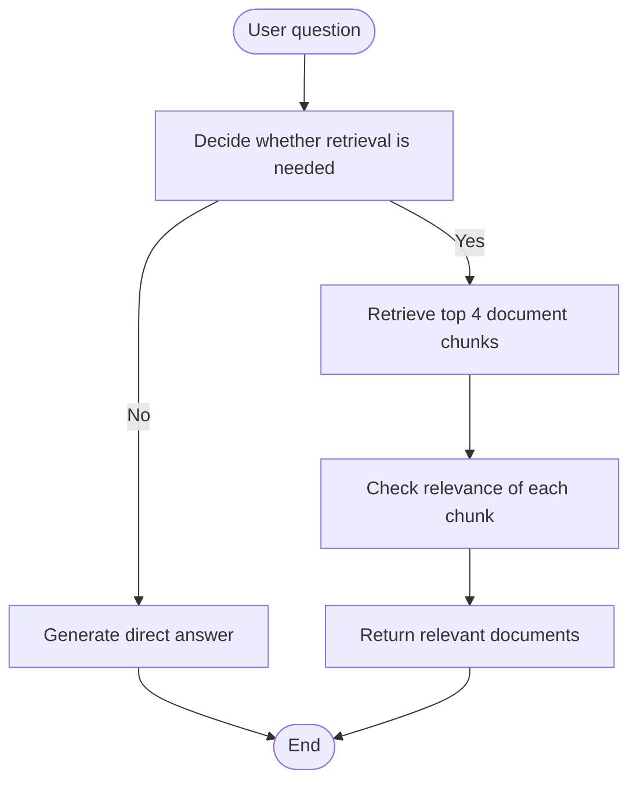

# Self-RAG: Conditional Retrieval with Document Relevance Filtering

A notebook-based RAG prototype built with **LangChain, LangGraph, FAISS, and OpenAI models**. The workflow first decides whether a question needs external information. When retrieval is needed, it searches company documents and uses an LLM to filter the retrieved passages for relevance.

> **Implementation status:** This notebook currently implements retrieval decision-making, document retrieval, and relevance filtering. The retrieval branch does **not yet generate a final answer from the filtered documents**. See [Current limitation and next steps](#current-limitation-and-next-steps).

## Overview

Traditional RAG pipelines usually retrieve documents for every question. This project adds a routing step so that retrieval is used only when the question requires specific information from the supplied documents.

The notebook uses three company PDFs as its knowledge source:

- `Company_Policies.pdf`
- `Company_Profile.pdf`
- `Product_and_Pricing.pdf`

The documents are loaded, split into overlapping chunks, embedded, and stored in a FAISS vector store. At query time, the workflow decides whether to answer directly or retrieve documents. Retrieved chunks are then checked individually for relevance.

## Workflow



### Step-by-step

1. **Load documents** – `PyPDFLoader` reads the three PDFs from the `documents/` directory.
2. **Split into chunks** – `RecursiveCharacterTextSplitter` creates chunks of 600 characters with 150 characters of overlap.
3. **Create embeddings and index** – `text-embedding-3-large` converts chunks into embeddings, which are indexed in FAISS.
4. **Decide whether to retrieve** – `gpt-4o-mini` returns a structured `should_retrieve` decision. The workflow defaults to retrieval when the decision is uncertain.
5. **Direct generation** – When retrieval is not needed, the model answers using general knowledge and is instructed not to assume access to the PDFs.
6. **Retrieve documents** – When retrieval is needed, the FAISS retriever returns the four most similar chunks (`k=4`).
7. **Filter for relevance** – The model evaluates each retrieved chunk against the question and retains chunks marked relevant.

## Tech stack

| Component | Technology | Purpose |
|---|---|---|
| LLM | OpenAI `gpt-4o-mini` | Retrieval decision, relevance judgement, and direct responses |
| Embeddings | OpenAI `text-embedding-3-large` | Convert document chunks into vectors |
| Vector store | FAISS | Similarity search over document embeddings |
| Orchestration | LangGraph | Define the state and conditional workflow |
| Document loading | LangChain `PyPDFLoader` | Load PDF files |
| Text splitting | `RecursiveCharacterTextSplitter` | Split documents into overlapping chunks |
| Structured output | Pydantic | Validate the retrieval and relevance decisions |

## Project structure

Arrange the project files like this:

```text
self-rag/
├── documents/
│   ├── Company_Policies.pdf
│   ├── Company_Profile.pdf
│   └── Product_and_Pricing.pdf
├── self_rag_step2.ipynb
├── .env
├── .gitignore
└── README.md
```

The notebook uses paths relative to the current working directory. Keep the `documents/` folder alongside the notebook, or update the paths in the document-loading cell.

## Setup and run

### 1. Clone the repository

```bash
git clone <your-repository-url>
cd self-rag
```

### 2. Create and activate a virtual environment

```bash
python -m venv .venv
```

Windows PowerShell:

```powershell
.venv\Scripts\Activate.ps1
```

macOS / Linux:

```bash
source .venv/bin/activate
```

### 3. Install dependencies

```bash
pip install langchain-community langchain-openai langchain-text-splitters langchain-core langgraph pydantic python-dotenv pypdf faiss-cpu jupyter
```

### 4. Configure the OpenAI API key

Create a `.env` file in the project root:

```env
OPENAI_API_KEY=your_openai_api_key
```

Do not commit your `.env` file or expose your API key in the notebook or repository.

### 5. Add the source PDFs

Place the three PDF files in the `documents/` folder, using the filenames shown above.

### 6. Run the notebook

Start Jupyter:

```bash
jupyter notebook
```

Open `self_rag_step2.ipynb` and run the cells from top to bottom. The notebook creates the FAISS vector store in memory when the indexing cell runs.

## Configuration

The main settings are currently defined directly in the notebook:

| Setting | Current value |
|---|---:|
| Chunk size | 600 characters |
| Chunk overlap | 150 characters |
| Retrieval count (`k`) | 4 |
| Embedding model | `text-embedding-3-large` |
| Chat model | `gpt-4o-mini` |
| Chat temperature | `0` |

You can experiment with chunk size, overlap, and `k` to see how they affect retrieval quality. Evaluate changes with a consistent set of questions rather than relying on a single example.

## Example query

The notebook includes this example:

```python
result = app.invoke(
    {
        "question": "Who is the CEO of NexaAI",
        "need_retrieval": False,
        "docs": [],
        "answer": "",
    }
)
```

The retrieval decision is set to `True` for this question, and the retrieved/relevant document content identifies **Aarav Mehta** as the CEO and founder of NexaAI. In the current graph, that information is available in `result["relevant_docs"]`; the retrieval path does not yet put it into `result["answer"]`.

## LangGraph state

The graph carries the following state:

| Field | Description |
|---|---|
| `question` | User's question |
| `need_retrieval` | Whether the question needs document retrieval |
| `docs` | Chunks returned by the vector retriever |
| `relevant_docs` | Retrieved chunks judged relevant by the LLM |
| `answer` | Answer produced by the direct-generation branch |

## Current limitation and next steps

The current graph has two paths:

- **No retrieval:** `decide_retrieval → generate_direct → END`
- **Retrieval:** `decide_retrieval → retrieve → is_relevant → END`

The retrieval path ends after relevance filtering. It does not yet contain a generation node that uses `relevant_docs` to produce a document-grounded answer. As a result, a retrieval-required question can return relevant passages while leaving the `answer` field empty.

A natural next improvement is to add a **grounded answer-generation node** after `is_relevant`. That node should answer using only `relevant_docs`, handle the case where no relevant chunks remain, and return the generated response in `answer`. After that, test both routes with a small set of questions covering general knowledge, document-specific facts, irrelevant retrieval results, and questions not answered by the documents.

## Security and usage notes

- Keep API keys in environment variables; never commit `.env`.
- Only use documents you are authorized to process.
- OpenAI API calls for embeddings and chat completions may incur usage charges.
- The FAISS index is built in memory by the notebook; this implementation does not include persistent index storage.

## License

Add a license before publishing or redistributing this project. No license is specified in the notebook.
